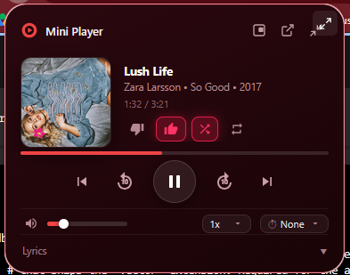
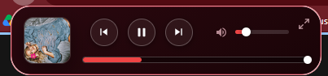

# Mini Player - YTMusic

Extensão para Firefox que adiciona um mini player para controlar o YouTube Music e o YouTube a partir de qualquer guia.

## Interface

### Modo completo


### Modo resumido


## Funcionalidades

- Controles de reprodução (Play/Pause, próxima faixa, faixa anterior e avanço/retrocesso de 10s)
- Curtir, descurtir, modo aleatório (shuffle) e repetição sincronizados com o YouTube Music
- Ajuste de volume e barra de progresso arrastáveis
- Alternância entre modo completo, modo resumido e janela destacada (pop-out)
- Controle de velocidade de reprodução (`0.5x` a `2x`) e temporizador de pausa (Sleep Timer)
- Visualização da letra da música atual

## Estrutura

```text
Mini Player - YTMusic/
├── icons/
├── popup/
│   ├── popup.html
│   ├── popup.css
│   └── popup.js
├── screenshots/
├── background.js
├── ytm-controller.js
└── manifest.json
```

## Instalação (Desenvolvimento)

1. No Firefox, acesse `about:debugging`.
2. Clique em **Este Firefox** (*This Firefox*).
3. Clique em **Carregar extensão temporária...** e selecione o arquivo `manifest.json`.
