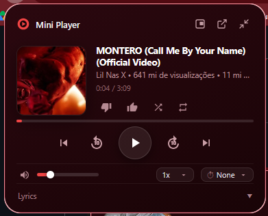
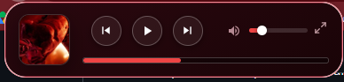

# Mini Player - YTMusic

Extensão para Firefox que adiciona um mini player para controlar o YouTube Music e o YouTube a partir de qualquer guia.

[](https://addons.mozilla.org/pt-BR/firefox/addon/mini-player-para-youtube-music/)

## Interface

### Modo completo


### Modo resumido


## Funcionalidades

- Controles de reprodução (Play/Pause, próxima faixa, faixa anterior e avanço/retrocesso de 10s)
- Curtir, descurtir, modo aleatório (shuffle) e repetição sincronizados com o YouTube Music
- Ajuste de volume e barra de progresso arrastáveis
- Alternância entre modo completo, modo resumido e janela destacada (pop-out)
- Controle de velocidade de reprodução (`0.5x` a `2x`) e temporizador de pausa (Sleep Timer)
- Visualização da letra da música atual

## Estrutura

```text
MiniPlayer-YTMusic-Firefox/
├── icons/
│   ├── icon-48.png
│   ├── icon-96.png
│   ├── icon-128.png
│   └── icon.svg
├── popup/
│   ├── popup.html
│   ├── popup.css
│   └── popup.js
├── screenshots/
├── background.js
├── ytm-controller.js
├── manifest.json
└── LICENSE
```

## Instalação

### Loja Oficial (Firefox Add-ons)

Você pode instalar diretamente pela página oficial de complementos do Firefox:
- **[Mini Player para YouTube Music no Firefox Add-ons](https://addons.mozilla.org/pt-BR/firefox/addon/mini-player-para-youtube-music/)**

### Desenvolvimento Local

1. No Firefox, acesse `about:debugging`.
2. Clique em **Este Firefox** (*This Firefox*).
3. Clique em **Carregar extensão temporária...** e selecione o arquivo `manifest.json`.

## Empacotamento para Publicação (Firefox Add-ons / AMO)

Para gerar o pacote `.zip` limpo pronto para submissão na loja oficial do Firefox:

```bash
zip -r -FS miniplayer-ytmusic-firefox.zip \
  manifest.json background.js ytm-controller.js popup/ icons/ LICENSE
```

## Licença

Distribuído sob a licença [MIT](./LICENSE).
